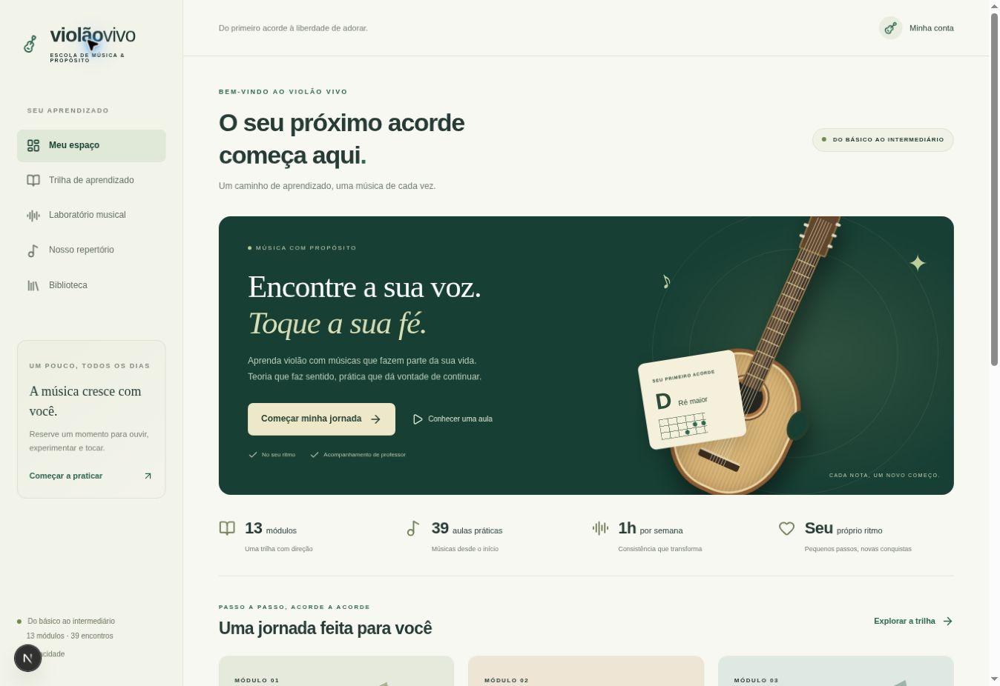

# Violão Vivo

**Do primeiro acorde à liberdade de adorar.** Aplicação web de ensino de violão gospel, do básico ao intermediário, baseada nos materiais v5 do curso: **13 módulos, 39 aulas e um encontro semanal de 60 minutos**.

O repositório é **público**, conforme a decisão atual do proprietário. O código e os materiais editoriais estão disponíveis no GitHub; contas, progresso e anotações pessoais ficam no Supabase, protegidos por autenticação e políticas de acesso.



_Registro visual da primeira versão. A revisão atual exige matrícula confirmada e está descrita nas [evidências de verificação](docs/VERIFICATION.md)._

## O que está implementado

- **Aluno:** conta e confirmação do código de matrícula enviado pelo professor; após o vínculo, trilha por módulo, conclusão de aula, confiança e anotações, diário de prática, agenda e devolutivas.
- **Professor:** turmas com código de entrada, acompanhamento individual, planos das aulas, encontros semanais, feedback e validação da execução.
- **Apresentação das aulas:** sete etapas por aula, navegação por teclado e resposta revelada pelo professor, usando o conteúdo original das 39 aulas.
- **Prática:** cifras organizadas por trechos, pausa/continuação, início e repetição de cada passagem; repetição do arranjo e metrônomo acionáveis sem interromper os acordes. Inclui referências de andamento pesquisadas, diagramas, braço interativo, afinação de referência e percepção auditiva. Os controles são responsivos e as instruções de uso ficam em dicas acessíveis por toque ou teclado.
- **Laboratório musical:** oficinas de pulso de memória, escuta com seis perguntas e comparação sonora, localização de notas sem mapa e ferramentas livres. Resultados da rodada orientam a próxima prática; não concluem aulas nem ficam gravados na conta.
- **Teoria em ação:** laboratórios ligados a R1–R8 para explorar intervalos, escalas, formação de acordes, campo harmônico, centro modal e empréstimo; exemplos autorais com áudio e perguntas de recuperação.
- **Conteúdo:** aulas completas, consultas teóricas com navegação de ida e volta, links de vídeos/gravações/cifras e PDFs originais. Primeira pestana no módulo 5, após as 12 aulas iniciais.
- **Segurança:** papel de professor concedido administrativamente, validação no servidor, RLS por usuário/vínculo de turma e respostas privadas sem cache público.

A conclusão declarada pelo aluno e a execução validada pelo professor são registros distintos. As ferramentas não avaliam automaticamente a execução instrumental.

## Como o curso é liberado

1. O professor cria uma turma na área docente.
2. Ele envia o código diretamente ao aluno, fora do aplicativo, pelo canal combinado.
3. O aluno entra na própria conta e confirma o código no painel.
4. Somente depois da matrícula confirmada são liberados aulas, teoria, repertório, laboratório, materiais, agenda e diário.

Criar uma conta não libera o curso. Sem matrícula, o painel mostra apenas a conta e o formulário de confirmação. A regra é verificada no servidor e no banco, inclusive em acessos diretos às APIs. As antigas rotas de demonstração também exigem matrícula. O professor mantém acesso para preparar e ministrar as aulas.

Ao remover o último vínculo com uma turma, o acesso do aluno é bloqueado novamente; o histórico pessoal fica preservado para uma futura matrícula. A regra controla o acesso pelo aplicativo. Como o repositório permanece público por decisão do proprietário, materiais já publicados no GitHub continuam acessíveis por lá.

**Antes de publicar esta versão:** aplicar também [`202611140002_course_enrollment.sql`](supabase/migrations/202611140002_course_enrollment.sql) no Supabase. Ela complementa a migration inicial e protege progresso/práticas contra acesso direto sem matrícula. O procedimento está no [deployment](docs/DEPLOYMENT.md#atualizar-um-projeto-existente-para-exigir-matrícula).

## Executar localmente

Requisitos: **Node.js 22 LTS** e npm.

```bash
npm ci
npm run dev
```

Abrir [localhost:3000](http://localhost:3000). **Sem variáveis Supabase**, ficam disponíveis somente a apresentação pública e a página de privacidade. Login exige o projeto configurado; conteúdo e ferramentas exigem também matrícula ou papel de professor.

Para usar contas e persistência:

```bash
cp .env.example .env.local
```

Editar `.env.local` com a URL e a chave publicável do seu Supabase; definir `NEXT_PUBLIC_SITE_URL=http://localhost:3000`. Aplicar as migrations e configurar Auth conforme [publicação e ambiente](docs/DEPLOYMENT.md). Reiniciar `npm run dev`. Nenhuma chave administrativa é necessária no aplicativo.

```bash
npm run check  # lint, tipos, testes e build
npm start     # depois de um build bem-sucedido
npm run test:http:ci # inicia o servidor de produção, testa as rotas e encerra
```

Os testes cobrem contratos, casos negativos, integridade do conteúdo e RLS em PostgreSQL/PGlite com usuários sintéticos. O teste de banco local não comprova callbacks OAuth, SMTP ou configuração do Supabase hospedado; a matriz de validação externa está no guia de publicação.

## Tecnologias e organização

| Camada               | Tecnologia                                                      |
| -------------------- | --------------------------------------------------------------- |
| Interface e backend  | Next.js **16.4.6**, React **19.3.1**, TypeScript                |
| Autenticação SSR     | `@supabase/ssr` **0.12.7**, `@supabase/supabase-js` **2.119.0** |
| Persistência         | PostgreSQL no Supabase, migrations SQL e RLS                    |
| Validação            | Zod; constraints e permissões no banco                          |
| Qualidade            | ESLint, TypeScript, Node Test Runner, PGlite                    |
| Hospedagem principal | Vercel Hobby, uso **pessoal e não comercial**                   |

As versões exatas resolvidas estão no `package-lock.json`. Frontend e Route Handlers são publicados juntos; as funções acessam o banco com a sessão do usuário. Não há persistência de usuários no disco do servidor.

```text
src/app/              páginas, APIs e callbacks Auth
src/components/       interface e ferramentas musicais
src/content/          conteúdo v5 e proveniência
src/lib/              contratos, validação, comandos e consultas
supabase/             migrations, RLS e promoção de professor
materials/            PDFs e guia original, públicos no repositório
scripts/              importação reproduzível do curso
tests/                regras, segurança e isolamento
docs/                 arquitetura, operação, cotas e metodologia
```

## Publicar automaticamente pela main

1. Criar um projeto **Supabase Free**, aplicar as migrations e habilitar Google OAuth. Cadastro/recuperação por e-mail exigem SMTP próprio para atender todos os alunos.
2. Publicar o código na `main` do [repositório GitHub](https://github.com/marcosrioj/violao-basico-intermediario).
3. Importar esse repositório pessoal na **Vercel Hobby**, preset Next.js, Node 22, Install Command `npm ci`, Build Command **`npm run check`** e Production Branch **`main`**.
4. Cadastrar as três variáveis de `.env.example`, usando a URL gratuita `*.vercel.app`, e configurar os retornos de autenticação no Supabase.
5. Criar a conta do professor, promovê-la pelo procedimento administrativo e validar o fluxo com dois alunos diferentes.

Depois dessa conexão, um novo commit enviado à `main` dispara build e publicação, se os checks passarem. Nenhum upgrade, domínio pago ou cobrança automática por consumo é necessário ao desenho inicial. A integração com contas, migrations remotas, OAuth/SMTP, promoção do professor e primeiro deployment são configurações externas; os arquivos do projeto não as executam sozinhos.

O passo a passo, limites e comportamento em caso de cota esgotada estão em [DEPLOYMENT.md](docs/DEPLOYMENT.md) e [FREE-TIER.md](docs/FREE-TIER.md). Usar Vercel Hobby somente quando o uso for pessoal e não comercial; para uso comercial, seguir a alternativa Netlify Free documentada.

## Configurações de produção e confirmação de cadastro

Endereço público desta instalação: [Violão Vivo](https://violao-basico-intermediario-iota.vercel.app). Em outra instalação, substituir essa origem nos três lugares: variável da Vercel, Site URL do Supabase e Redirect URLs do Supabase.

### 1. Variáveis na Vercel

Em **Settings → Environment Variables**, selecionar o ambiente **Production**:

| Variável                               | Valor                                                                                    |
| -------------------------------------- | ---------------------------------------------------------------------------------------- |
| `NEXT_PUBLIC_SUPABASE_URL`             | URL do projeto Supabase usado pela aplicação, como `https://SEU_PROJECT_REF.supabase.co` |
| `NEXT_PUBLIC_SUPABASE_PUBLISHABLE_KEY` | Chave **publishable** desse mesmo projeto; copiar do painel, sem gravar o valor no Git   |
| `NEXT_PUBLIC_SITE_URL`                 | `https://violao-basico-intermediario-iota.vercel.app`                                    |

Depois de alterar essas variáveis, fazer **Redeploy** ou publicar um novo commit na `main`: os valores `NEXT_PUBLIC_*` são incorporados ao build. No desenvolvimento, manter `NEXT_PUBLIC_SITE_URL=http://localhost:3000` em `.env.local`. A aplicação não precisa de `service_role` nem da senha do banco. [Variáveis da Vercel](https://vercel.com/docs/environment-variables)

### 2. Site URL no Supabase

No mesmo projeto Supabase usado pela Vercel, abrir **Authentication → URL Configuration**. Preencher o campo **Site URL**, sem caminho ou código de confirmação:

```text
https://violao-basico-intermediario-iota.vercel.app
```

**Clicar em Save changes na seção Site URL.** Esse campo controla o retorno padrão e é salvo separadamente da lista abaixo. Salvar somente as Redirect URLs não altera o Site URL; mudar a variável da Vercel também não altera o painel Supabase.

### 3. Redirect URLs no Supabase

Na seção **Redirect URLs**, adicionar e salvar cada uma destas URLs exatas:

```text
https://violao-basico-intermediario-iota.vercel.app/auth/callback
https://violao-basico-intermediario-iota.vercel.app/auth/callback?next=%2Fredefinir-senha
https://violao-basico-intermediario-iota.vercel.app/auth/confirm
```

As três entradas atendem cadastro/login, recuperação de senha e templates personalizados de confirmação. Os retornos para `localhost` estão no [guia de configuração de autenticação](docs/DEPLOYMENT.md#3-configurar-autenticação). [Redirects do Supabase](https://supabase.com/docs/guides/auth/redirect-urls)

### 4. Templates e teste do e-mail

Manter a confirmação de e-mail habilitada e configurar SMTP para atender os alunos. O template padrão com `{{ .ConfirmationURL }}` usa o callback do aplicativo; abrir o link no mesmo navegador em que o cadastro ou a recuperação foi iniciado. Para confirmação em outro dispositivo, os modelos com `{{ .SiteURL }}` e `{{ .TokenHash }}` estão em [DEPLOYMENT.md](docs/DEPLOYMENT.md#cadastro-confirmação-e-recuperação-por-e-mail).

Se o e-mail abrir um domínio antigo ou retornar 404, conferir primeiro o **Site URL** e seu botão **Save changes**; depois, as Redirect URLs e qualquer domínio escrito diretamente no template. Após salvar, solicitar um novo e-mail e testar cadastro e recuperação: mensagens antigas não são reescritas. Se a conta já tiver sido confirmada antes do erro de redirecionamento, tentar entrar normalmente com e-mail e senha. Essas configurações do painel não são aplicadas por migrations nem por commits na `main`.

## Documentação

- [Verificações executadas e pendências](docs/VERIFICATION.md)
- [Arquitetura e contratos](docs/ARCHITECTURE.md)
- [Padrões de engenharia aplicados](docs/ENGINEERING.md)
- [Identidade e voz do Violão Vivo](docs/brand-guidelines.md)
- [Sistema visual, componentes e aplicação das skills](docs/DESIGN-SYSTEM.md)
- [Execução, Supabase, GitHub e publicação](docs/DEPLOYMENT.md)
- [Planos gratuitos e fontes oficiais consultadas](docs/FREE-TIER.md)
- [Conteúdo, origem e reimportação](docs/CONTENT.md)
- [Pesquisa pedagógica e limites da evidência](docs/PEDAGOGY-RESEARCH.md)
- [Laboratório: oito estudos e decisões de aprendizagem](docs/LABORATORY-RESEARCH.md)
- [Andamentos das 13 gravações, unidades e fontes](docs/TEMPO-RESEARCH.md)
- [Exportação e exclusão de dados pessoais](docs/DATA-ADMINISTRATION.md)

## Código público, materiais e dados pessoais

Os PDFs e planos do professor estão em um repositório público. As rotas do app respeitam o papel da conta, mas não tornam esses arquivos confidenciais no GitHub. Os registros reais de pessoas ficam exclusivamente no Supabase e não devem ser incluídos em commits, testes ou backups versionados.

Nenhuma licença de software foi escolhida nesta entrega. A publicação do código não define automaticamente uma licença MIT ou outra licença de reutilização. Letras, gravações e materiais de terceiros mantêm seus direitos e condições próprios; o aplicativo aponta para as fontes externas e não redistribui gravações comerciais. O campo `private` do `package.json` impede publicação acidental no npm; não altera a visibilidade pública do GitHub.
