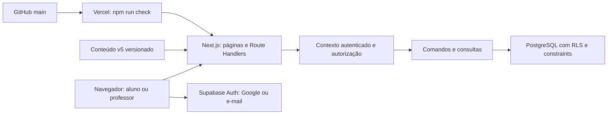

# Arquitetura do Violão Vivo

O projeto reúne o curso gospel básico ao intermediário e o acompanhamento semanal em um monólito modular. O conteúdo editorial é versionado; o progresso e as relações entre pessoas são persistidos no Supabase. Não há servidor continuamente ativo nem dependência de disco local para guardar dados de usuários.

## Fronteiras

- `src/app`: rotas, composição das páginas, callbacks de autenticação e adaptadores HTTP.
- `src/components`: apresentação compartilhada e ferramentas musicais interativas no navegador.
- `src/content`: módulos, aulas, teoria, referências, plano do professor e proveniência extraídos dos materiais.
- `src/lib/contracts.ts` e `validation.ts`: DTOs e schemas de entrada.
- `src/lib/application`: comandos de escrita e consultas de leitura.
- `src/lib/supabase`: clientes oficiais separados por ambiente; o cliente de servidor carrega a sessão da requisição.
- `src/lib/auth.ts`, `http.ts` e `errors.ts`: autenticação, papel, origem, limite de corpo, respostas e registro seguro.
- `supabase/migrations`: esquema, funções e políticas. `supabase/promote-teacher.sql` é operação administrativa separada.

A escolha de Next.js/React e as versões efetivamente instaladas estão no manifesto e lockfile. A linha Next.js 16 recebeu correções relevantes em novembro de 2026; atualizações futuras devem preservar os testes de isolamento e a ausência de cache compartilhado de dados privados. [Release oficial de segurança](https://nextjs.org/blog/november-2026-security-release)

## Autenticação e autorização

Supabase Auth verifica identidade. O servidor usa `getUser()` e carrega o perfil protegido no banco; sessão presente em cookie não basta para permitir operação. O papel padrão criado pelo trigger é `student`, mesmo se metadados enviados pelo cliente disserem outra coisa. A promoção é administrativa, sem endpoint público.

O professor administra as próprias turmas. O aluno acessa os próprios registros. O professor pode consultar o progresso e as práticas dos alunos matriculados em uma de suas turmas, para acompanhar o curso; esse progresso pertence ao aluno, e não a uma turma específica. Feedback e encontros pertencem à turma. A remoção de um vínculo pelo próprio aluno ou pelo professor proprietário deve ser considerada junto com os efeitos de cascata documentados na migration: feedback daquela matrícula é removido; progresso pessoal permanece.

Todas as tabelas expostas têm RLS. Chamadas comuns usam a sessão do usuário e a chave publicável, preservando essas políticas. Não existe cliente `service_role` no fluxo do aplicativo. Funções SQL com privilégios elevados são pequenas, têm `search_path` explícito e verificam papel/vínculo antes de agir. A matrícula por código possui limite persistido de tentativas.

Mutações HTTP exigem origem igual a `NEXT_PUBLIC_SITE_URL`. JSON é limitado e validado com Zod; IDs e relacionamentos são conferidos também no banco. Respostas privadas usam `Cache-Control: private, no-store`. Logs registram operação, status, duração e identificador; não registram notas do aluno, corpo de formulário, cookies, senha ou token.

## Modelo de dados

| Tabela                  | Responsabilidade                             | Escopo de leitura                              |
| ----------------------- | -------------------------------------------- | ---------------------------------------------- |
| `profiles`              | Nome, papel e fuso IANA; ID vinculado a Auth | Próprio usuário e professor de aluno vinculado |
| `classrooms`            | Turma com professor proprietário             | Professor proprietário e aluno matriculado     |
| `classroom_invites`     | Código de entrada da turma                   | Professor proprietário                         |
| `memberships`           | Vínculo único entre turma e aluno            | Próprio aluno e professor proprietário         |
| `lesson_progress`       | Estado, notas e confiança por aluno/aula     | Aluno e professor vinculado                    |
| `practice_logs`         | Sessão de prática, minutos, BPM e observação | Aluno e professor vinculado                    |
| `feedback`              | Devolutiva e validação do professor          | Aluno destinatário e professor da turma        |
| `lesson_sessions`       | Encontro com instante e link HTTPS opcional  | Participantes da turma                         |
| `private.join_attempts` | Controle de tentativas de matrícula          | Apenas função controlada no banco              |

O identificador editorial da aula é `m1-a1` até `m13-a3`. Módulo e aula continuam separados para exibir a numeração reiniciada. Constraints impedem referências de aula fora desse catálogo. Mudar a estrutura do currículo exige alterar conteúdo, validação e constraint por migration coordenada.

A criação da turma e do convite ocorre em uma transação SQL. Matrícula repetida preserva um único vínculo. O progresso é um upsert por aluno/aula; eventos de prática usam UUID para evitar duplicação em retentativa do mesmo envio. Instantes são `timestamptz`; o perfil mantém o fuso de apresentação.

## Contrato HTTP

Operações autenticadas retornam `{ "data": ... }`. Falhas retornam `{ "error": { "code", "message", "requestId" } }` e status HTTP apropriado. Listas de práticas, turmas, feedback e encontros usam `page`, tamanho fixo de 20 e `hasMore`; o progresso retorna no máximo 39 aulas. O cliente não determina uma página ilimitada.

| Caminho                                           | Operações         | Uso                                                        |
| ------------------------------------------------- | ----------------- | ---------------------------------------------------------- |
| `/api/me`                                         | GET, PATCH        | Consultar e editar nome/fuso                               |
| `/api/progress`                                   | GET, PUT          | Consultar e registrar estado de aula                       |
| `/api/practice`                                   | GET, POST         | Diário de prática                                          |
| `/api/classes`                                    | GET, POST         | Listar e criar turma                                       |
| `/api/classes/[id]`                               | GET, DELETE       | Detalhe paginado; remover vínculo autorizado (`studentId`) |
| `/api/classes/[id]/students/[studentId]/practice` | GET               | Diário paginado de aluno matriculado na turma do professor |
| `/api/classes/join`                               | POST              | Matrícula pelo código                                      |
| `/api/feedback`                                   | GET, POST         | Ler e enviar devolutivas                                   |
| `/api/sessions`                                   | GET, POST, DELETE | Ler, agendar e cancelar encontros (`id`)                   |
| `/api/auth/logout`                                | POST              | Encerrar sessão                                            |

Os schemas em `validation.ts` e handlers são a referência executável para campos e permissões. Campos de autoria são derivados da sessão; IDs de outro aluno só são aceitos nos comandos próprios do professor, com checagem do vínculo.

## Conteúdo e interação

O curso preserva 13 módulos com três aulas, encontro semanal de uma hora e a entrada da primeira pestana no módulo 5. As consultas teóricas e suas menções possuem navegação de ida e volta. O conteúdo do professor fica em módulo de servidor, separado dos dados serializados para aluno.

Diagramas, braço do instrumento, metrônomo, reprodução de sequências e percepção auditiva executam localmente no navegador. A Web Audio API sintetiza sons para demonstração; não há streaming de gravação comercial nem serviço de IA. O aluno inicia o áudio e pode pará-lo. A precisão do relógio de áudio depende do dispositivo e das limitações do navegador; metrônomo não avalia a execução do aluno.

PDFs são materiais editoriais de leitura, fora da pasta `public`, com entrega por rota autorizada no aplicativo. Como o repositório GitHub é público por decisão do proprietário, os PDFs em `materials/` e os textos do manual do professor também podem ser consultados diretamente no GitHub. A autorização organiza a experiência do app; não fornece sigilo para conteúdo editorial público. Não há upload de dados pessoais nesta versão; Supabase Storage é dispensável. Adicionar gravações de alunos exigiria bucket privado, políticas, limites de tipo/tamanho e ciclo de vida próprios.

## Verificação e limites

`npm run check` é a entrada para checks locais e build da hospedagem. Casos de RLS usam banco de teste com usuários sintéticos. O resultado confirma as políticas naquele ambiente, não a configuração de um projeto Supabase ainda não conectado. Depois da publicação, repetir a matriz de duas contas e professor em [DEPLOYMENT.md](DEPLOYMENT.md).

Sem credenciais, demonstração não se apresenta como sessão real. Não há escrita de usuários em JSON, `localStorage` ou arquivo no servidor. Configuração externa e quotas ficam documentadas em [FREE-TIER.md](FREE-TIER.md). O mapa dos padrões recebidos está em [ENGINEERING.md](ENGINEERING.md).
