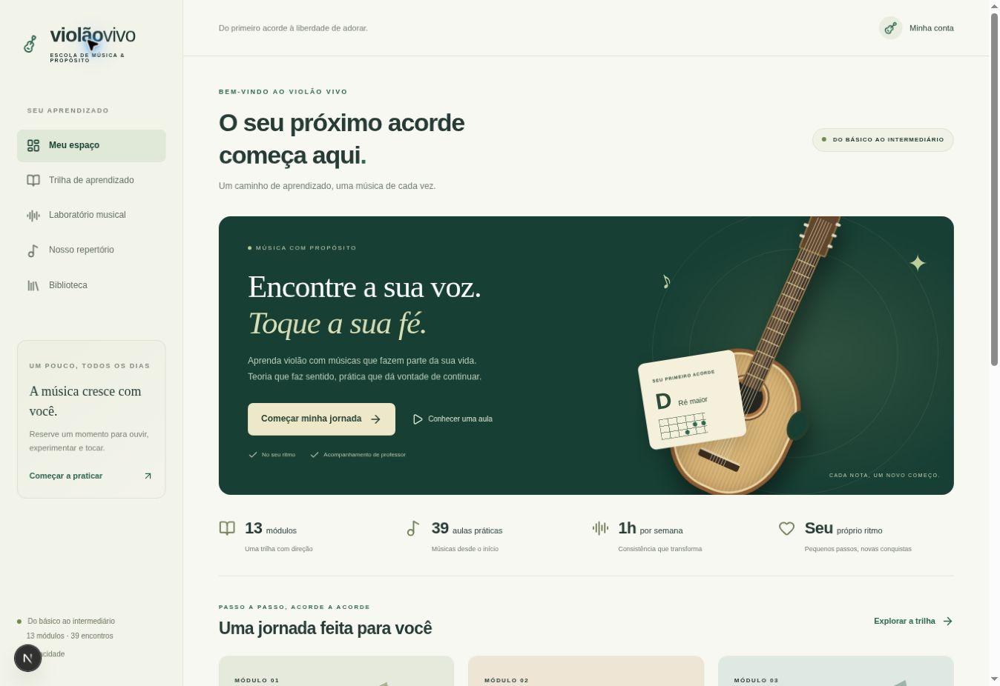

# Entrega e evidências de verificação

Registro de **14 de novembro de 2026**. O projeto está na branch `main`. Este documento distingue o código entregue, os testes executados e as configurações que dependem de contas externas.

## Correção dos links de confirmação em produção

Após incorporar a versão remota `cda8fd9`, a correção de redirects passou localmente em `npm run check`: ESLint, TypeScript, **46 testes** e build Next.js. O smoke HTTP contra esse build passou em **32 verificações**, incluindo os três caminhos antigos de confirmação/recuperação. Os códigos usados nos testes são fictícios; os redirects foram inspecionados sem seguir o callback nem consumir códigos de usuários.

Cadastro e recuperação agora usam `/auth/callback`; links personalizados por `token_hash` continuam compatíveis. O relay de links antigos preserva a origem do navegador e remove parâmetros alheios ao fluxo. O teste HTTP também detectou e corrigiu o uso do hostname interno do servidor em `/auth/confirm`, com um `Location` relativo.

A inspeção pública confirmou que `https://violao-basico-intermediario-iota.vercel.app` responde e contém a origem correta no JavaScript. Um token deliberadamente inválido confirmou que o retorno padrão do Supabase ainda apontava ao domínio antigo no momento do diagnóstico. A correção administrativa de Site URL/Redirect URLs está descrita em [DEPLOYMENT.md](DEPLOYMENT.md); ela não é aplicada pelo código. O fluxo completo com e-mail real e sessão autenticada permanece pendente de validação após salvar essa configuração.

## Versão consolidada aprovada

O commit `c8402aa8c206d3e15122a03ea73e38a88f4f6304` passou na [execução 43609584947 do GitHub Actions](https://github.com/marcosrioj/violao-basico-intermediario/actions/runs/43609584947), com Node.js 22.23.4:

| Verificação                   | Resultado confirmado                                                     |
| ----------------------------- | ------------------------------------------------------------------------ |
| Instalação pelo lockfile      | `npm ci` concluído; audit informou zero vulnerabilidades naquele momento |
| ESLint                        | Aprovado                                                                 |
| Geração de tipos e TypeScript | Aprovados                                                                |
| Testes automatizados          | **42 passaram; zero falhas, cancelamentos ou testes ignorados**          |
| Build Next.js de produção     | Aprovado                                                                 |
| Smoke HTTP contra o build     | **29 verificações passaram**                                             |

A execução inclui os arquivos recuperados e os oito laboratórios teóricos. Os testes cobrem navegação e conteúdo, regras musicais, autenticação, configuração pública e isolamento em banco. O smoke confirma o comportamento sem sessão e sem Supabase configurado; não equivale a login real com contas hospedadas. Alterações posteriores exclusivamente neste relatório não alteram o código testado; cada novo commit continua acionando o mesmo workflow.

## Evidência da implementação-base

A implementação-base `59908af087c441824e923054ae788b441e1de4fd` passou em instalação reproduzível, ESLint, geração de tipos, TypeScript, **14 testes** e build Next.js de produção. A execução foi confirmada no [GitHub Actions, run 43580731986](https://github.com/marcosrioj/violao-basico-intermediario/actions/runs/43580731986).

O relatório inicial também registra **29 verificações HTTP** locais, isolamento de usuários no PostgreSQL/PGlite, rastreamento dos PDFs na saída serverless e formatação. Essas contagens pertencem à implementação-base, não representam o total de testes acrescidos depois.

## Consolidação e regressões

A revisão acrescenta verificações para configuração pública segura, logout independente do perfil, recuperação de senha sem repetir uma alteração já confirmada, chaves React únicas, navegação da teoria demonstrativa, grafia diatônica de escalas e duração do áudio.

Antes da indisponibilidade do ambiente local, passaram os testes focados das correções de autenticação e das ferramentas musicais, além de tipos e lint dessas alterações. Os laboratórios teóricos ampliados foram integrados posteriormente por recuperação do código. O ambiente perdido não permitiu comparar byte a byte todos os arquivos recuperados nem repetir toda a suíte local.

A verificação autoritativa de cada commit consolidado está no [workflow Verificação](https://github.com/marcosrioj/violao-basico-intermediario/actions/workflows/ci.yml). Conferir o SHA da execução, seu resultado e os logs: eles registram a contagem efetivamente executada para aquela versão. A CI instala com `npm ci` e executa:

1. ESLint.
2. Geração de tipos de rotas e TypeScript.
3. Testes de conteúdo, domínio, ferramentas musicais, configuração, autenticação e RLS.
4. Build Next.js de produção.
5. Smoke HTTP contra uma instância desse build, iniciada e encerrada pelo wrapper.

O teste de RLS executa o SQL real da migration em PostgreSQL/PGlite com identidades sintéticas. A fronteira `auth.uid()` é emulada por sessão; isso não testa emissão/renovação de JWT, OAuth ou a configuração de um projeto Supabase hospedado. [Detalhes de segurança](VERIFICATION-security.md).

## Revisão no navegador

A interface foi inspecionada em navegador desktop durante a execução local. Foram observados:

- Tela inicial, demonstração da primeira aula e seus diagramas/arranjo.
- Acesso à consulta R1 da demonstração e retorno à ocorrência exata na aula.
- Navegação por âncora até “Tocar junto”.
- Seleção do refrão, repetição, início e parada do player.
- Metrônomo em 6/8 com dois pulsos e subdivisão ternária.
- Seleção de nota no braço e atualização da leitura correspondente.
- Desafio auditivo com resposta e explicação.
- Tela de login sem credenciais indicando a necessidade de configuração, sem simular uma conta.

A revisão encontrou e corrigiu chaves React duplicadas, navegação da consulta demonstrativa para login e o aviso de navegação com rolagem suave. A captura abaixo é da interface implementada, não um mockup:



A revisão desktop não cobre auditoria integral WCAG, leitor de tela, zoom, dispositivos móveis ou tablets. A interação completa dos oito laboratórios ampliados não foi revalidada visualmente depois da recuperação. Os testes automatizados correspondentes cobrem suas regras musicais, mas não substituem essa inspeção.

## Comandos reproduzíveis

```bash
npm ci
npm run check
npm run test:http:ci
```

`test:http:ci` requer o build gerado por `check`; inicia o Next em loopback, executa verificações sem contas e encerra o processo. `npm run test:http` permanece disponível para um servidor já iniciado. Nenhum desses testes cria um Supabase remoto ou uma conta de aluno.

## Configurações externas pendentes

1. Criar/selecionar Supabase Free e aplicar `supabase/migrations/202611140001_initial.sql`.
2. Habilitar Google OAuth e configurar Site URL e redirects. Para cadastro/recuperação por e-mail fora da equipe, configurar SMTP.
3. Cadastrar o professor e promover o papel pelo script administrativo.
4. Conectar o repositório à hospedagem elegível, cadastrar as três variáveis e definir `main` como branch de produção.
5. Manter o GitHub público, conforme a decisão atual do proprietário; credenciais e registros pessoais permanecem fora do repositório.
6. Executar a matriz real com duas contas de aluno e duas de professor após a configuração.

Essas pendências registram o estado da entrega inicial. Posteriormente, foi observada uma publicação em `https://violao-basico-intermediario-iota.vercel.app` com Supabase configurado. A verificação pública não comprova a aplicação integral das migrations, as configurações administrativas ou o isolamento de contas reais. Não foram contratados serviços pagos nesta sessão.

Após conectar as contas, verificar: login, renovação, recuperação e logout; aluno A conclui aula e retoma após novo login; aluno B não lê seus registros; professor correto vê progresso/diário e envia feedback; outro professor recebe negação; matrícula e saída atualizam acesso; agenda respeita fuso; aluno não baixa manual pela rota do app; vídeos carregam somente após clique; áudio para ao navegar; referências de teoria retornam ao trecho exato.

O passo a passo está em [DEPLOYMENT.md](DEPLOYMENT.md), incluindo publicação automática por commit e validação do SHA publicado.
